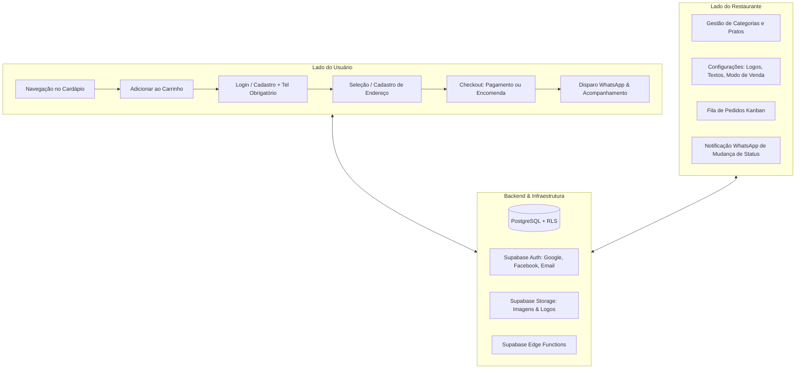

# Arquitetura do Sistema: Cardápio Virtual Dinâmico

## 1. Visão Geral
O **Cardápio Virtual Dinâmico** foi concebido como uma solução moderna, white-label e flexível para restaurantes, lanchonetes e bares.
Ele combina uma experiência do usuário móvel fluida (mobile-first) para pedidos presenciais ou delivery com um painel administrativo completo de controle de cardápio e gestão de fila de pedidos.

## 2. Camadas da Aplicação
1. **Frontend (SPA)**:
   - React 18/19 com Vite.
   - Bootstrap 5 + Bootstrap Icons.
   - Design System dinâmico: suporte a personalização de cores primárias e secundárias pelo admin do restaurante.
2. **Camada de Dados e Autenticação (Supabase)**:
   - Gerenciamento de usuários via Supabase Auth (com OAuth Google, Facebook e email/senha).
   - Armazenamento em PostgreSQL com políticas RLS (Row Level Security).
   - Storage Buckets com permissões públicas para leitura e autenticadas para escrita/upload pelo admin.
3. **Comunicação e Notificações**:
   - Geração de mensagens estruturadas para o WhatsApp do cliente e do restaurante.
   - Fallback instantâneo com link `wa.me` para compatibilidade total mesmo sem gateways pagos.
   - Edge Functions integráveis a gateways (Evolution API, Z-API, Baileys, Twilio).

## 3. Matriz de Permissões (Segurança e RLS)
| Tabela | Visitante Anônimo | Cliente Autenticado | Administrador |
| :--- | :--- | :--- | :--- |
| `restaurants` | Leitura pública | Leitura pública | Leitura e Edição total |
| `categories` | Leitura de ativas | Leitura de ativas | CRUD completo |
| `dishes` | Leitura de ativos | Leitura de ativos | CRUD completo |
| `profiles` | Sem acesso | Apenas próprio ID | Leitura para atendimento |
| `customer_addresses` | Sem acesso | Apenas próprio ID | Leitura para entrega |
| `orders` | Criação de pedido | Próprios pedidos | Todos os pedidos da loja |
| `order_items` | Criação de itens | Próprios itens | Todos os itens da loja |
| `order_status_logs` | Sem acesso | Próprios pedidos | Todos os logs |
